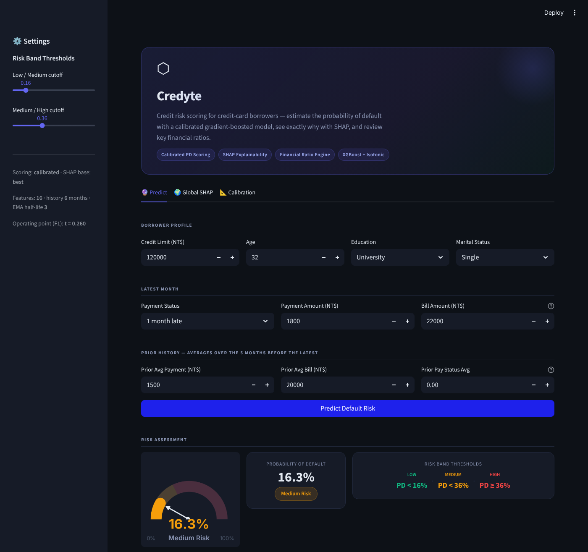
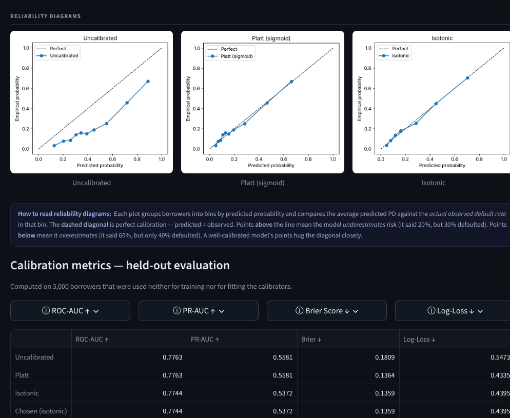
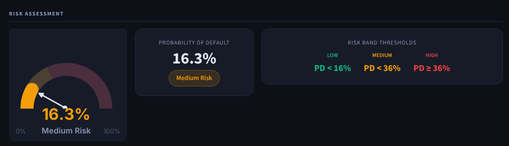
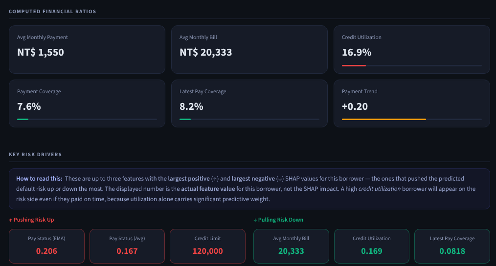
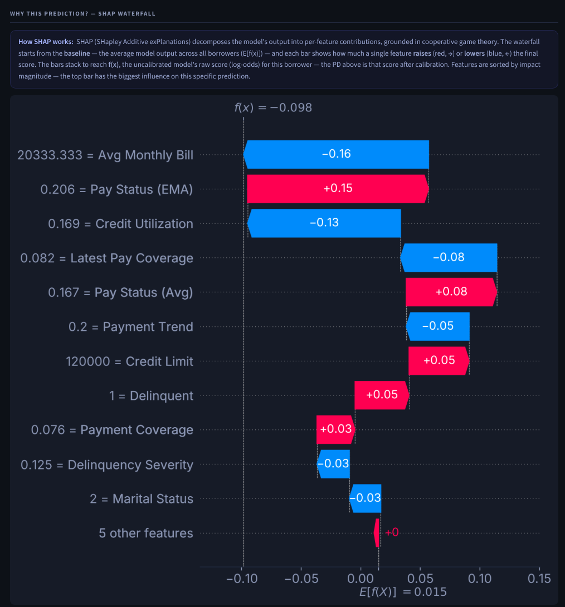
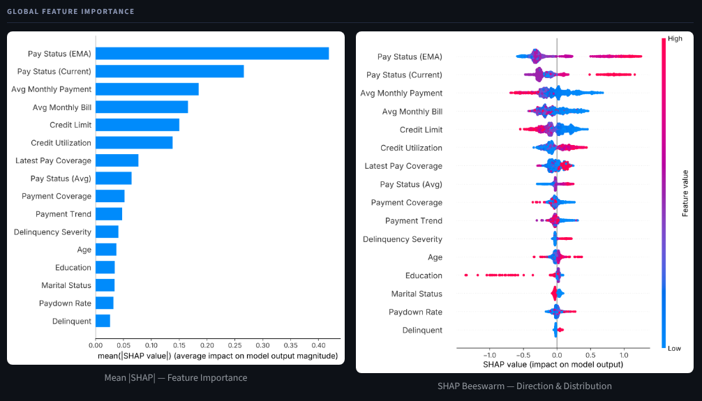

# ⬡ Credyte — Explainable Credit Default Prediction

[](https://github.com/Anou-shka/credyte/actions/workflows/ci.yml)


**Credyte** predicts the probability that a credit-card customer will **default on next month's payment**. It explains every prediction feature by feature, in an interactive Streamlit dashboard.

It is built like a small production credit-scoring system:

- **Calibrated probabilities.** A score of 16% means about 16 in 100 similar borrowers default, not just "riskier than average".
- **A leakage-free evaluation pipeline.** Train, calibration and evaluation data never overlap.
- **One feature-engineering code path** shared by training and the app, with tests that guarantee they match.



---

## 🎯 The problem

Lenders have to decide which accounts to approve, limit or watch. A useful risk model has to:

1. **Rank** risky borrowers above safe ones. Measured with ROC-AUC.
2. Output **trustworthy probabilities**, because pricing and expected-loss calculations need them. Measured with Brier score and calibration curves.
3. **Explain itself**, so analysts can justify decisions and spot bad behaviour in the model. Done with SHAP.

Credyte covers all three.

## 📊 Results

Data: the [UCI *Default of Credit Card Clients*](https://archive.ics.uci.edu/dataset/350/default+of+credit+card+clients) dataset. It has 30,000 Taiwanese credit-card holders with 6 months of billing and repayment history (Apr–Sep 2005). The target is default in Oct 2005, which has a base rate of 22.1%.

All numbers below are measured on borrowers the model **never saw during training**.

| Model (holdout, 6,000 borrowers) | ROC-AUC | PR-AUC |
|---|---|---|
| Logistic regression (baseline) | 0.743 | 0.514 |
| **XGBoost** | **0.779** | **0.565** |

| Calibration (evaluation split, 3,000 borrowers) | Brier ↓ | Log-loss ↓ |
|---|---|---|
| XGBoost, uncalibrated | 0.181 | 0.547 |
| + Platt scaling | 0.136 | 0.434 |
| **+ Isotonic regression (chosen)** | **0.136** | 0.440 |

- Calibration cuts the Brier score by **25%** with no loss in ranking power.
- The F1-optimal decision threshold is **0.26**: precision 0.52, recall 0.55.
- For reference, published results on this dataset are typically around 0.77–0.79 ROC-AUC.

<p align="center"></p>

---

## ✨ Features

| | |
|---|---|
| **Calibrated PD scoring** | XGBoost + isotonic calibration, fitted on rows held out from training |
| **Risk banding** | Low / Medium / High bands centred on the F1-optimal threshold, adjustable in the sidebar |
| **Per-borrower explanations** | SHAP waterfall plus "risk up / risk down" driver cards showing the borrower's actual values |
| **Global explainability** | SHAP bar and beeswarm plots across the portfolio |
| **Financial ratio engine** | Credit utilisation, payment coverage, paydown rate, payment trend, delinquency signals |
| **Calibration diagnostics** | Reliability diagrams and a metrics table for Uncalibrated vs Platt vs Isotonic |
| **Batch scoring** | `python -m src.score` scores a whole CSV into PD + risk band |

### Prediction & explanation

<p align="center"></p>
<p align="center"></p>
<p align="center"></p>

### What drives default risk overall

<p align="center"></p>

The strongest signals are **recent payment behaviour**: the current and recency-weighted payment status. Payment amounts and credit utilisation come next. Demographics contribute little.

---

## 🧠 How it works

```
data/data.csv (raw UCI)
   │  src/prepare_data.py     clean codes, build "latest month" + "prior 5-month average" inputs
   ▼
data/final_dataset.csv
   │  src/features.py         16 engineered features (shared by training AND the app)
   │  src/train.py            stratified 80/20 split → logistic regression + XGBoost (early stopping)
   ▼                          → best model by holdout ROC-AUC; holdout rows saved to models/splits.json
models/best.joblib
   │  src/calibrate.py        holdout only: 50% fit Platt & isotonic, 50% evaluate → pick by Brier
   ▼                          → choose operating threshold by F1
models/calibrated_best.joblib
   │  src/explain.py          global SHAP plots           src/score.py   batch scoring
   ▼
app.py (Streamlit)            calibrated PD + SHAP explanation for one borrower
```

### Feature engineering

The app asks for a deliberately small input: a profile, the latest month, and averages over the 5 prior months. From these it computes:

| Feature | Definition | Captures |
|---|---|---|
| `avg_pay_amt`, `avg_bill_amt` | (5 × prior average + latest) / 6 | 6-month payment and bill levels |
| `credit_utilization` | avg bill / credit limit, clipped to [0, 1] | How much of the limit is used |
| `repay_ratio_avg` | avg payment / avg bill, clipped to [0, 1]; 1 when nothing is owed | Payment coverage |
| `cur_recent` | latest payment / latest bill, same rule | Most recent coverage |
| `paydown_ratio` | avg payment / credit limit | How aggressively debt is paid down |
| `payment_trend` | (latest payment − prior avg) / (prior avg + 1), clipped to ±1 | Improving or worsening? |
| `pay_status_current`, `pay_status_avg` | Latest and 6-month average repayment status | Lateness |
| `pay_status_ema` | Exponentially weighted status (half-life 3 months) | Recency-weighted delinquency trend |
| `pay_is_delinquent`, `pay_severity` | status > 0; max(0, status) / 8 | Currently late, and how badly |

Plus `LIMIT_BAL`, `AGE`, `EDUCATION` and `MARRIAGE`. `SEX` is intentionally excluded.

### Engineering decisions worth noting

- **No data leakage in calibration.** Calibrators are fitted only on rows the model was not trained on (`models/splits.json`). Fitting them on training rows makes the model look better calibrated than it is.
- **No train/serve skew.** The app builds features with the same `compute_features` function used in training. A unit test checks that single-row and batch outputs are identical. Feature parameters are read from the trained model's metadata rather than exposed as knobs.
- **Class imbalance.** XGBoost uses `scale_pos_weight` to rank the minority class well. That inflates raw probabilities, which calibration then corrects.
- **Reproducibility.** Fixed seeds, pinned dependencies, and a scripted data-prep step that matches the exploratory notebook exactly.

---

## ⚡ Quickstart

```bash
git clone https://github.com/Anou-shka/credyte.git
cd credyte

python -m venv venv
source venv/bin/activate             # Windows: venv\Scripts\activate
pip install -r requirements.txt

streamlit run app.py                 # → http://localhost:8501
```

Pre-trained models are included, so the app runs immediately.

### Reproduce everything from raw data

```bash
python -m src.prepare_data    # data/data.csv → data/final_dataset.csv
python -m src.train           # models/best.joblib, baseline.joblib, metrics.json, splits.json
python -m src.calibrate       # models/calibrated_best.joblib, operating_point.json, reliability plots
python -m src.explain         # images/shap/ global SHAP plots
python -m src.score           # data/scored.csv (PD + risk band for every row)

pip install pytest && python -m pytest tests
```

---

## 🗂 Project structure

```
credyte/
├── app.py                    # Streamlit dashboard
├── src/
│   ├── prepare_data.py       # Raw UCI CSV → clean minimal-input table
│   ├── features.py           # Feature engineering (shared by training & app)
│   ├── train.py              # Logistic regression + XGBoost training, model selection
│   ├── calibrate.py          # Platt / isotonic calibration, threshold selection
│   ├── explain.py            # Global SHAP plots
│   └── score.py              # Batch scoring + risk bands
├── models/                   # Trained models, metrics, schema, holdout split
├── data/                     # Raw, cleaned and scored data
├── images/                   # Screenshots, SHAP and calibration plots
├── notebook/                 # Exploratory data cleaning
├── tests/                    # Feature-engineering tests (pytest)
└── .github/workflows/ci.yml  # Runs the tests on every push
```

---

## ⚠️ Limitations

- **Data age and scope.** The data covers one Taiwanese bank in 2005, so this is a demonstration of methodology, not a model for real lending decisions.
- **Use of demographics.** The model uses age, education and marital status. A real credit model would need a fair-lending review of these. `SEX` is excluded.
- **Data quirk.** The "Other" education category has an unusually low default rate in the source data, and the model picks this up.
- **Monitoring.** There is no time-based validation or drift monitoring; the dataset spans a single 6-month window.

## 🛠 Tech stack

Python · pandas · NumPy · scikit-learn · XGBoost · SHAP · Matplotlib · Streamlit · pytest · GitHub Actions

## 📜 License

[MIT](LICENSE) © 2025 Anoushka Nahata

## 💡 Acknowledgements

- Yeh, I. C., & Lien, C. H. (2009). *The comparisons of data mining techniques for the predictive accuracy of probability of default of credit card clients.* Expert Systems with Applications. Data from the [UCI Machine Learning Repository](https://archive.ics.uci.edu/dataset/350/default+of+credit+card+clients).
- [SHAP](https://github.com/shap/shap) by Scott Lundberg et al.
